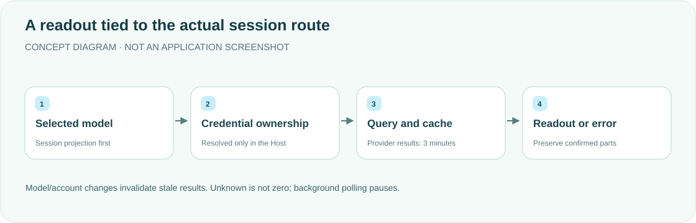

<div align="center">

<h1>dsh-edu · Quota and balances</h1>
<p><strong>See the remaining allowance for the model you are actually using.</strong></p>
<p>Session-aware quota readouts beneath the DeepSeek Harness composer.</p>
<p><a href="README.md">简体中文</a> · <strong>English</strong></p>
<p><a href="package.json">v0.1.2</a> · <a href="LICENSE">MIT</a> · DSH desktop plugin</p>
<p><a href="#features">Features</a> · <a href="#how-it-works">How it works</a> · <a href="#quick-start">Quick start</a> · <a href="#credentials-and-refresh">Credentials and refresh</a> · <a href="#validation">Validation</a></p>
</div>

---

A reference implementation for a personal DSH desktop workflow, not a general billing platform. It queries supported providers without presenting another account's balance as the current route's. Credentials remain in the Host; the browser requests only `/api/dsh-edu`.

## Features

<table><tr>
<td width="33%"><strong>📊 Provider readouts</strong><br/><br/>Codex 5-hour/7-day limits, Grok/SuperGrok weekly limits, DeepSeek API balances and Zhipu cash balances.</td>
<td width="33%"><strong>🔄 Session-aware</strong><br/><br/>The official modelSelection.next projection wins. Model changes clear old numbers rather than borrowing a default account.</td>
<td width="33%"><strong>🧩 Visible partial failure</strong><br/><br/>A failed Zhipu package query preserves confirmed cash with a warning. Unknown is not zero.</td>
</tr><tr>
<td><strong>⏱ Bounded caching</strong><br/><br/>Successful provider/credential results cache for 3 minutes; concurrent requests share a query.</td>
<td><strong>🛡 Host-only credentials</strong><br/><br/>Reuse DSH credentials without storing another token or reading other clients' authentication files.</td>
<td><strong>🌙 Background pause</strong><br/><br/>Serial polling resumes immediately in the foreground, with short backoff for failed package queries.</td>
</tr></table>

## How it works



The session projection takes priority over historical requests. Only an existing new session with no selection/request uses the default model. Missing sessions or failed projection services report errors rather than querying an unrelated account.

## Quick start

Requires DeepSeek Harness desktop with compatible session projection/slot APIs and existing credentials for the selected model.

```sh
export DSH_HOME="${DSH_HOME:-$HOME/.dsh}"
git clone https://github.com/yueyexiayu/dsh-edu.git "$DSH_HOME/plugins/dsh-edu"
```

Merge this entry into `$DSH_HOME/profiles/desktop/cordis.patch.yml`:

```yaml
- insert:
    - id: dsh-edu
      name: ../../plugins/dsh-edu/lib/index.js
```

Keep other plugins intact. **Quit DSH fully with ⌘Q and reopen it.** Select a supported model and check the readout below the composer. A page refresh does not fully reload Host/Client code.

## Credentials and refresh

| Item | Behavior |
| --- | --- |
| GPT / Grok | `llm-pi-ai/openai-codex` / `llm-pi-ai/xai` OAuth; explicit API Key routes do not borrow another OAuth account |
| Official DeepSeek API | Route `apiKeyEnv`, defaulting to `DEEPSEEK_API_KEY` |
| pi-ai DeepSeek / Zhipu | Explicit reference → stored route Key → native reference; a missing explicit reference fails |
| Zhipu references | `ZAI_CODING_CN_API_KEY` / `ZAI_API_KEY` |
| Foreground polling | Normally 2 seconds; unsupported providers 30 seconds; Client requests time out after 20 seconds |
| Package partial failure | `warning`, `state: partial_retry` and `retryAfterMs`; retry the failed part after about 30 seconds |

<details>
<summary><strong>Account isolation and strict display rules</strong></summary>

Account changes, logout, renewal and credential/route edits invalidate stale results; late responses cannot restore them. Cash and packages cache separately. `packages: null` means failure; `[]` means confirmed absence of active packages.

Unsupported providers are neither displayed nor queried. Custom service addresses, overridden authentication headers and ambiguous legacy routes fail explicitly. Unknown usage is not 0%; malformed percentages, dates and types are rejected, while real negative cash remains negative.

The plugin does not read `~/.grok/auth.json` or `~/.codex/auth.json`. Official `deepseek-account` login balances remain in the official UI; this plugin's DeepSeek balance targets API Key routes.

</details>

## Validation

```sh
cd "$DSH_HOME/plugins/dsh-edu"
for file in lib/*.js; do node --check "$file" || exit 1; done
node --test
```

Product tests use mock credentials and responses, not real accounts or quota endpoints. They cover switching, caches, late responses, partial failure and parser boundaries. Historical 0.1.2 browser fixtures are not real-account end-to-end acceptance. **This update validates documentation and layout only; product tests were not rerun and the desktop was not restarted.**

## License

[MIT License](LICENSE). To uninstall, remove only this plugin's desktop-patch entry and fully restart DSH; do not delete other plugins or production credentials.

<div align="center"><sub>Accountable readouts. Unknown is not zero. · <a href="README.md">阅读中文版 →</a></sub></div>
