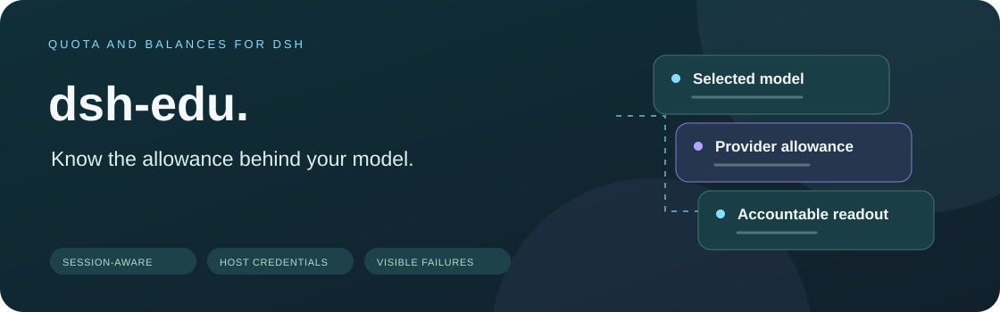
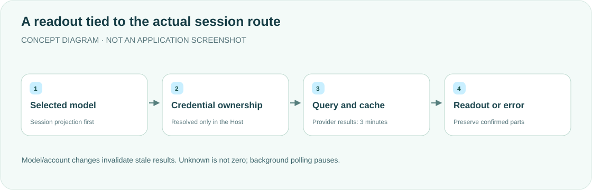

<div align="center">

<h1>Usage</h1>
<p><strong>See the remaining allowance for the model you are actually using.</strong></p>
<p>Session-aware quota readouts beneath the DeepSeek Harness composer.</p>
<p><a href="README.md">简体中文</a> · <strong>English</strong></p>
<p><a href="package.json">v0.1.11</a> · <a href="LICENSE">MIT</a> · DSH desktop plugin</p>
<p><a href="#features">Features</a> · <a href="#how-it-works">How it works</a> · <a href="#model-platforms">Model platforms</a> · <a href="#quick-start">Quick start</a> · <a href="#credentials-and-refresh">Credentials and refresh</a> · <a href="#validation">Validation</a></p>
</div>

---

A reference implementation for a personal DSH desktop workflow, not a general billing platform. It queries supported providers without presenting another account's balance as the current route's. Credentials remain in the Host; the browser requests only `/api/dsh-edu`.

## Features

<table><tr>
<td width="33%"><strong>📊 Provider readouts</strong><br/><br/>Codex 5-hour/7-day limits, Grok/SuperGrok weekly limits, OpenCode Go 5-hour/weekly/monthly usage, DeepSeek API balances and Zhipu cash balances.</td>
<td width="33%"><strong>🔄 Session-aware</strong><br/><br/>The official modelSelection.next projection wins. Model changes clear old numbers rather than borrowing a default account.</td>
<td width="33%"><strong>🧩 Visible partial failure</strong><br/><br/>A failed Zhipu package query preserves confirmed cash with a warning. Unknown is not zero.</td>
</tr><tr>
<td><strong>⏱ Bounded caching</strong><br/><br/>Successful provider/credential results default to a configurable 3-minute cache; concurrent requests share a query.</td>
<td><strong>🛡 Host-only credentials</strong><br/><br/>Reuse DSH credentials without storing another token or reading other clients' authentication files.</td>
<td><strong>🌙 Background pause</strong><br/><br/>Serial polling resumes immediately in the foreground, with short backoff for failed package queries.</td>
</tr><tr>
<td colspan="3"><strong>⚙️ Model platforms on the plugin page</strong><br/><br/>Add, remove and configure model platforms plus refresh, cache, timeout, alert thresholds and readout visibility on Plugins → Usage; saved real queries synchronize immediately.</td>
</tr></table>

## How it works



The session projection takes priority over historical requests. Only an existing new session with no selection/request uses the default model. Missing sessions or failed projection services report errors rather than querying an unrelated account.

## Model platforms

The Usage plugin detail page adds, removes, enables, disables and renames model platforms. Codex, Grok, OpenCode Go, DeepSeek and Zhipu start as built-in platforms and can be re-added after removal.

- Normal and unsupported-model refresh intervals, successful-result cache lifetime and upstream request timeout.
- Whether each platform is queried and shown, its display name, warning threshold and critical threshold.
- Whether reset countdowns and refresh age are shown.
- Custom balance platforms: bind a configured DSH provider and enter an HTTPS balance endpoint, Bearer or x-api-key authentication, and JSON paths for balance and currency. The API key comes from that DSH provider route and is never written to plugin settings or returned to the browser.

Platforms live in `$DSH_HOME/storages/dsh-edu/settings.json` and use revisions so concurrent windows cannot silently overwrite each other. Existing fixed-category settings migrate automatically. Saving an add, removal or edit invalidates old query caches; a removed or disabled platform disappears, while a newly bound active provider makes a real request on the next configured poll. Credential and account changes also discard old readouts. DSH model routes, credentials, model selection and request parameters remain owned by the official model settings.

## Quick start

Requires DeepSeek Harness desktop with compatible session projection/slot APIs and existing credentials for the selected model.

```sh
export DSH_HOME="${DSH_HOME:-$HOME/.dsh}"
git clone https://github.com/yueyexiayu/dsh-edu.git "$DSH_HOME/plugins/dsh-edu"
```

If you install through the DSH plugin manager, enable it on its page. For a manual install, merge this entry into `$DSH_HOME/profiles/desktop/cordis.patch.yml`:

```yaml
- insert:
    - id: dsh-edu
      name: ../../plugins/dsh-edu/lib/index.js
```

Keep other plugins intact. **Quit DSH fully with ⌘Q and reopen it.** Open Plugins → Usage → Model platforms, add or remove a platform, select its model and check the real readout below the composer. A page refresh does not fully reload Host/Client source code.

## Credentials and refresh

| Item | Behavior |
| --- | --- |
| GPT / Grok | `llm-pi-ai/openai-codex` / `llm-pi-ai/xai` OAuth; explicit API Key routes do not borrow another OAuth account |
| OpenCode Go | Covers both the shipped `opencode-go` route (adapter default endpoint when no `baseURL` is set) and a custom `https://opencode.ai/inference/go/...` route; the route's `apiKeyEnv` (for example `OPENCODE_GO_API_KEY`) reads `/zen/go/v1/usage`. Percentages only: no plan tier and no Zen cash balance. An explicit custom gateway address is not claimed |
| Official DeepSeek API | Route `apiKeyEnv`, defaulting to `DEEPSEEK_API_KEY` |
| pi-ai DeepSeek / Zhipu | Explicit reference → stored route Key → native reference; a missing explicit reference fails |
| Zhipu references | `ZAI_CODING_CN_API_KEY` / `ZAI_API_KEY` |
| Foreground polling | Defaults of 2 seconds for normal polling and 30 seconds for unsupported providers are configurable; Client requests have a 65-second cap covering up to two configurable serial upstream calls |
| Package partial failure | `warning`, `state: partial_retry` and `retryAfterMs`; retry the failed part after about 30 seconds |

<details>
<summary><strong>Account isolation and strict display rules</strong></summary>

Account changes, logout, renewal and credential/route edits invalidate stale results; late responses cannot restore them. Cash and packages cache separately. `packages: null` means failure; `[]` means confirmed absence of active packages.

Unsupported providers are neither displayed nor queried. Custom service addresses, overridden authentication headers and ambiguous legacy routes fail explicitly. Unknown usage is not 0%; malformed percentages, dates and types are rejected, while real negative cash remains negative.

The plugin does not read `~/.grok/auth.json` or `~/.codex/auth.json`. Official `deepseek-account` login balances remain in the official UI; this plugin's DeepSeek balance targets API Key routes.

</details>

## Validation

```sh
cd "$DSH_HOME/plugins/dsh-edu"
for file in lib/*.js; do node --check "$file" || exit 1; done
node --test
```

Product tests use mock credentials and responses, not real accounts or quota endpoints. They cover switching, caches, late responses, partial failure, parser boundaries, platform add/remove, add-control ordering, cross-window synchronization, legacy migration, the custom-balance request path, explicit/native credential precedence, credential-change invalidation, DSH bridge same-origin behavior, threshold display and disabled-platform no-query behavior. Historical 0.1.2 browser fixtures are not real-account end-to-end acceptance. **This update reran syntax checks and all 116 product tests. The v0.1.8 page is loaded in the desktop app, but this v0.1.11 Client change requires a full quit and reopen before it takes effect.**

## License

[MIT License](LICENSE). To uninstall, remove only this plugin's desktop-patch entry and fully restart DSH; do not delete other plugins or production credentials.

<div align="center"><sub>Accountable readouts. Unknown is not zero. · <a href="README.md">阅读中文版 →</a></sub></div>
