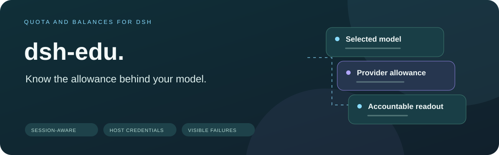
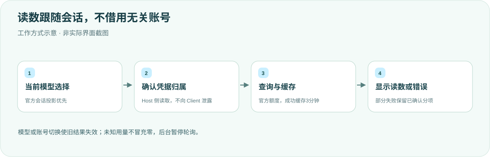

<div align="center">

<h1>dsh-edu · 额度与余额</h1>
<p><strong>看清正在使用的模型，还剩多少额度。</strong></p>
<p>DeepSeek Harness 输入框下方的会话感知额度读数。</p>
<p><strong>简体中文</strong> · <a href="README.en.md">English</a></p>
<p><a href="package.json">v0.1.3</a> · <a href="LICENSE">MIT</a> · DSH desktop plugin</p>
<p><a href="#核心能力">核心能力</a> · <a href="#工作方式">工作方式</a> · <a href="#快速开始">快速开始</a> · <a href="#凭据与刷新">凭据与刷新</a> · <a href="#验证">验证</a></p>
</div>

---

为个人 DSH 桌面工作流提供参考实现，不是通用账单平台。只查询当前支持的提供方，不以其他账号的余额冒充当前模型路由。所有凭据留在 Host，浏览器仅访问 `/api/dsh-edu`。

## 核心能力

<table><tr>
<td width="33%"><strong>📊 模型对应读数</strong><br/><br/>Codex 的5小时/7天限额，Grok/SuperGrok 周限额，DeepSeek API 与智谱现金余额。</td>
<td width="33%"><strong>🔄 跟随会话切换</strong><br/><br/>官方 modelSelection.next 投影优先；切换模型清除旧数字，不混用默认账号。</td>
<td width="33%"><strong>🧩 部分失败可见</strong><br/><br/>智谱资源包失败保留已确认现金，并显示警告；未知不显示为零。</td>
</tr><tr>
<td><strong>⏱ 有界缓存</strong><br/><br/>提供方与实际凭据成功结果缓存3分钟；同账号并发共用查询。</td>
<td><strong>🛡 凭据留在 Host</strong><br/><br/>沿用 DSH credentials，不另存 token，不读取其他客户端认证文件。</td>
<td><strong>🌙 后台暂停</strong><br/><br/>串行轮询、前台恢复立即刷新，资源包失败短退避，不无限重叠请求。</td>
</tr></table>

## 工作方式



会话投影优先于历史模型；已存在但尚无选择或请求的新会话才采用默认模型。会话不存在或投影服务失败时明确报错，不查询无关默认账号。

## 快速开始

需要兼容官方会话投影/槽位 API 的 DeepSeek Harness 桌面端，以及已配置的对应模型凭据。

```sh
export DSH_HOME="${DSH_HOME:-$HOME/.dsh}"
git clone https://github.com/yueyexiayu/dsh-edu.git "$DSH_HOME/plugins/dsh-edu"
```

将以下项合并到 `$DSH_HOME/profiles/desktop/cordis.patch.yml`：

```yaml
- insert:
    - id: dsh-edu
      name: ../../plugins/dsh-edu/lib/index.js
```

不要覆盖其他插件。**⌘Q 完全退出 DSH 后重开**，选择受支持模型，在输入框下方核对读数；仅刷新页面不完整重载 Host/Client。

## 凭据与刷新

| 项目 | 行为 |
| --- | --- |
| GPT / Grok | `llm-pi-ai/openai-codex` / `llm-pi-ai/xai` OAuth；显式 API Key 路由不借用其他 OAuth 账号 |
| DeepSeek 官方 API | 路由的 `apiKeyEnv`，默认 `DEEPSEEK_API_KEY` |
| pi-ai DeepSeek / 智谱 | 显式引用 → 路由保存 Key → 原生凭据引用；显式引用缺失时失败 |
| 智谱引用 | `ZAI_CODING_CN_API_KEY` / `ZAI_API_KEY` |
| 前台轮询 | 普通2秒；不支持提供方30秒；单次 Client 请求20秒上限 |
| 资源包部分失败 | 返回 `warning`、`state: partial_retry` 与 `retryAfterMs`，约30秒后重试失败分项 |

<details>
<summary><strong>账号隔离与严格显示规则</strong></summary>

换号、退出、续期或修改路由/凭据会使旧缓存失效；旧请求晚返回不能恢复旧读数。智谱现金和资源包分别缓存，`packages: null` 是失败，`[]` 才是确认没有生效资源包。

不支持的提供方不显示、不发官方查询。自定义服务地址、覆盖认证头或无法确定归属的旧路由明确显示错误。未知用量不当作0%，非法数值不当作零；拒绝非法百分比、日期和错误类型，同时保留真实负现金余额。

不读取 `~/.grok/auth.json` 或 `~/.codex/auth.json`。官方 `deepseek-account` 登录账号余额由官方界面提供，本插件的 DeepSeek 余额针对 API Key 路由。

</details>

## 验证

```sh
cd "$DSH_HOME/plugins/dsh-edu"
for file in lib/*.js; do node --check "$file" || exit 1; done
node --test
```

产品测试使用模拟凭据与接口响应，不读取真实账号、不调用实际额度服务；覆盖切换、缓存、晚响应、部分失败和解析边界。历史0.1.2浏览器夹具验证不等于真实账号端到端验收。**本次只做文档与排版检查，未重跑产品测试或重启桌面。**

## 许可

按 [MIT License](LICENSE) 发布。卸载时只移除本插件的 desktop patch 项，再完全重启；不要删除其他插件或正式凭据。

<div align="center"><sub>读数有归属，未知不冒充零。 · <a href="README.en.md">Read in English →</a></sub></div>
